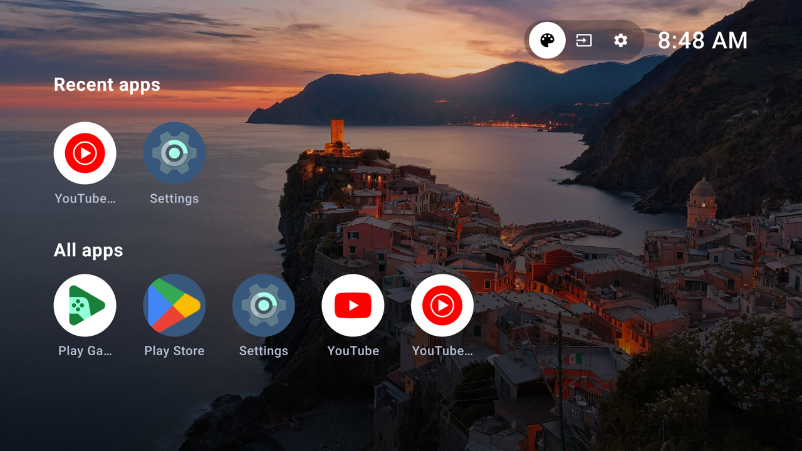
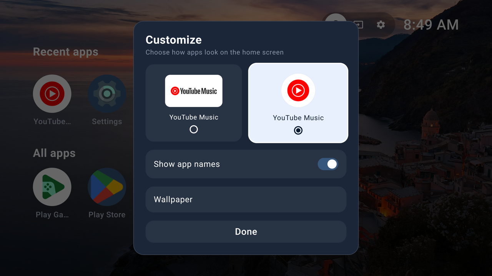
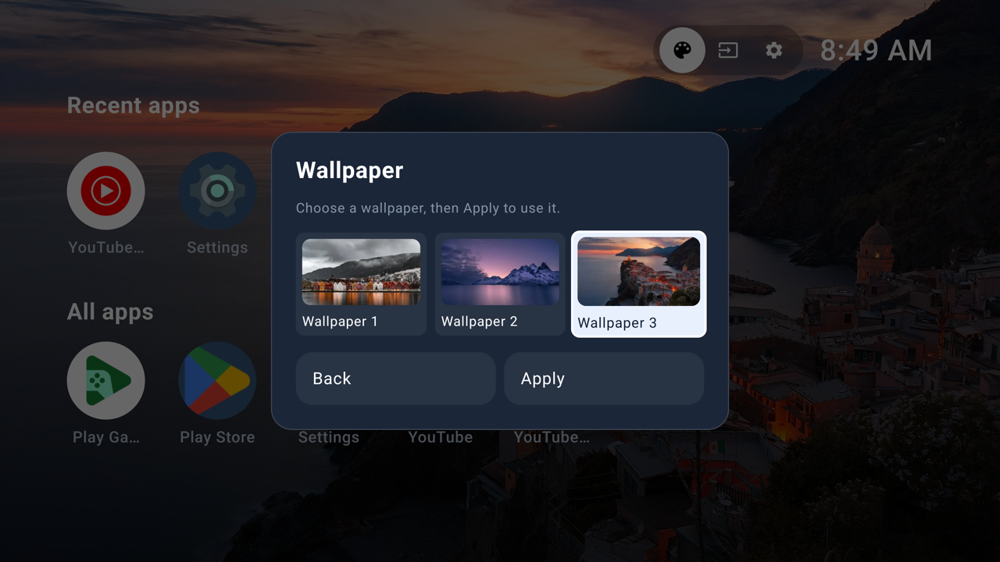

# TV Launcher

A simple, ad-free launcher for **Android TV and Google TV (Android 10+)**, built with Kotlin and Jetpack Compose.

Browse installed apps, jump back into your five most recently opened apps, and customize the home screen with circular icons or rectangular tiles, optional app names, and three wallpapers. Fully navigable with a TV remote.

## Screenshots

Captured from the app running on an Android TV emulator.



| Customize | Wallpapers |
|-----------|------------|
|  |  |

## Install

Build the APK using Android Studio or the command line (Android SDK and JDK 17+ required):

```bash
./gradlew :app:assembleDebug
```

The APK is at `app/build/outputs/apk/debug/app-debug.apk`. Alternatively, copy it to your TV and open it with a file manager allowed to **Install unknown apps**.

### Connect an Android TV

Enable Developer options by pressing **Build / Android TV OS build** seven times under **Settings → About**. Enable **ADB / Network debugging** if your device provides it, then connect from a computer on the same trusted network:

```bash
adb connect <TV_IP>:5555
```

Accept the debugging prompt on the TV. USB debugging alone does not enable network ADB on every TV; use the manufacturer's supported debugging method.

### Connect a Google TV

Enable Developer options under **Settings → System → About → Android TV OS build**, then enable **Wireless debugging** if available. Choose **Pair device with pairing code**:

```bash
adb pair <TV_IP>:<PAIRING_PORT>
adb connect <TV_IP>:<DEBUG_PORT>
```

Enter the pairing code when prompted. The pairing and debugging ports are different; use the values shown on the TV. If your Google TV only offers network ADB, use the Android TV method above.

### Install and open (both platforms)

```bash
adb devices
adb -s <TV_SERIAL> install -r app/build/outputs/apk/debug/app-debug.apk
adb -s <TV_SERIAL> shell am start -n com.techascent.tv_launcher/.MainActivity
```

Replace `<TV_SERIAL>` with the device identifier from `adb devices`, such as its IP and port. You can also open **TV Launcher** from the TV's app list.

**Optional default home:** first record your current home component, then try setting TV Launcher:

```bash
adb -s <TV_SERIAL> shell cmd package resolve-activity --brief -a android.intent.action.MAIN -c android.intent.category.HOME
adb -s <TV_SERIAL> shell cmd package set-home-activity --user 0 com.techascent.tv_launcher/.MainActivity
```

Save the first command's `package/activity` output. To restore it, run `set-home-activity --user 0 <ORIGINAL_HOME_COMPONENT>`. Home replacement depends on the device; some manufacturers block it. **Do not disable the stock launcher.** Turn off debugging when finished.

## Remote controls

| Control | Action |
|---------|--------|
| D-pad | Move between apps and header actions |
| OK | Open an app or select an option |
| Hold OK on an app | Open its dialog: Open / Uninstall (system apps cannot be uninstalled) |
| Customize icon | Change icon shape, app-name visibility, or wallpaper |
| Back | Dismiss a dialog or return to the top when scrolled |

Recent apps track launches made through this launcher. Wallpaper choices are applied with **Apply**; customization is saved between launches.
